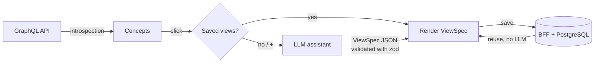

<div align="center">


# fluid

**Explore and shape your data the way Smalltalk inspectors let you explore objects, but on the web.**

Point fluid at any GraphQL API, browse its concepts, and describe the dashboard you want.
An LLM writes the view, you keep it, and it runs again without the LLM.

[**Live demo**](https://fluid.badetitou.fr) ·
[Getting started](#-getting-started) ·
[Plugins](#-plugins) ·
[Deployment](#-deployment) ·
[Architecture](docs/architecture/REARCHITECTURE.md)


</div>

---

## ✨ What is fluid?

fluid is an experiment in **interface-less web apps**. Instead of shipping pre-built screens, it
connects to a GraphQL endpoint, introspects its schema, and lets you **explore the concepts** (types)
of the backend yourself, column after column, like a Smalltalk inspector or a Miller-column browser.

Clicking a concept or an instance opens a **view**:

- 🗂️ **Views as inspector tabs.** If views already exist for that concept, fluid renders them, with a
  selector to switch between perspectives.
- 💬 **Describe, don't build.** If none exists (or you press **+**), an assistant opens, pre-prompted
  with the concept's schema and its neighbours. Say what you want to see; the LLM answers with a
  **declarative view spec** (tables, charts, stats: dashboards, not prose), streamed and previewed live.
- 💾 **Keep what you like.** Saved views are reused **without the LLM**: they take the concept (and
  instance) as a parameter and run as plain GraphQL queries.
- 🧩 **Extend everything.** Widgets, themes, view builders, data sources and page actions are
  **plugins** you enable, disable or install from a URL.

## 🔄 How it works



A **ViewSpec** is a hybrid model: a declarative JSON layout of parameterizable widgets, each bound to
a GraphQL query. It is rendered by an extensible widget catalog built on
[Ant Design](https://ant.design/) and [@ant-design/plots](https://charts.ant.design/).

## 🧱 Widget catalog

Widgets ship in built-in collections that you can turn on or off in *Settings → Plugins*:

| Collection | Widgets |
| --- | --- |
| **Essentials** | table, statistic, descriptions |
| **Charts** | line, bar, area, pie, scatter, sankey |
| **Code & text** | code, history, richtext |
| **Structure** | tree, accordion |
| **Graphs** | network (WebGL), class diagram, butterfly, dependency matrix |
| **Editing** | form (writes back through view actions) |
| **3D** | IFC building elements, alone or in their model (three.js, loaded on demand) |
| **Software maps** | polymetric boxes, class blueprint, overview pyramid (Moose) |
| **Inspectors** | Spec presenters served by Pharo / Moose backends |

Each widget type is a **contract** (zod schema, LLM documentation, input/output ports) plus a renderer,
so the prompt only ever describes widgets the frontend can actually render.

## 🚀 Getting started

### Requirements

- Node.js ≥ 22 and [pnpm](https://pnpm.io/) (`npm i -g pnpm`, or Corepack)
- Docker (e.g. [Colima](https://github.com/abiosoft/colima) on macOS) for the local PostgreSQL

### Run it

```bash
pnpm install                                 # 1. dependencies
docker compose up -d                         # 2. PostgreSQL for the BFF
pnpm --filter @fluid/bff prisma:migrate      # 3. BFF tables
pnpm dev                                     # 4. frontend + BFF in watch mode
```

fluid has no GraphQL backend of its own. The connection screen is pre-filled with the public
[Rick and Morty API](https://rickandmortyapi.com/graphql) and offers a few other public demo sources;
any CORS-enabled GraphQL endpoint with introspection works.

Copy `apps/bff/.env.example` to `apps/bff/.env` to configure the database and LLM providers. With
nothing set, the BFF uses an offline **mock** provider, so the assistant works out of the box.

### Useful commands

| Command | What it does |
| --- | --- |
| `pnpm dev` | Run every workspace in dev mode |
| `pnpm build` | Build every workspace |
| `pnpm -r typecheck` | Typecheck every workspace |
| `pnpm test` | Run the tests (vitest) |
| `node scripts/arch-metrics.mjs` | Architecture health indicators (`--json` for the log) |

### Single-process mode

To run fluid as one process (no nginx, no separate dev server), build the frontend and let the BFF serve it:

```bash
pnpm --filter @fluid/frontend build
FLUID_STATIC_DIR=$PWD/apps/frontend/dist pnpm --filter @fluid/bff start
# open http://localhost:4001
```

The BFF then serves the app at `/` (unknown non-`/api` paths fall back to `index.html`) and a generated `/config.js` pointing at the same origin. `FLUID_DEFAULT_GRAPHQL_URL` and `FLUID_IMAGE_HOSTS` are honoured as in the Docker image. Without `FLUID_STATIC_DIR` the BFF behaves as before.

## 🤖 LLM providers

| Provider | Setup |
| --- | --- |
| **Mock** | Default, offline, no setup |
| **OpenAI** (or any compatible API) | `OPENAI_API_KEY`, `OPENAI_MODEL`, `OPENAI_BASE_URL` |
| **Ollama** | `OLLAMA_BASE_URL`, `OLLAMA_MODEL` |
| **Claude** via your local Claude Code login | `claude` installed and logged in, see below |

Pick the default with `LLM_PROVIDER` (`openai | ollama | claude-code | mock`); users can override it in
**Settings → Configure LLM**.

<details>
<summary><b>Generating views with your Claude subscription</b></summary>

The assistant can use **Claude through your local Claude Code login** (Pro/Max subscription, no API key):

1. Install [Claude Code](https://docs.claude.com/en/docs/claude-code) on the machine that runs the
   BFF and run `claude` once to log in.
2. Start the stack with `pnpm dev`, open **Settings → Configure LLM** and pick
   **Claude (local Claude Code login)** (Sonnet by default, Opus or Haiku available).
3. Open a concept, press **+** and describe the view: Claude's output streams live, then the
   validated view is previewed and can be saved.

The BFF runs `claude -p` headless with tools, MCP servers, hooks and session persistence disabled,
using a Claude-tuned prompt. Optional env vars: `CLAUDE_CODE_BIN`, `CLAUDE_CODE_MODEL`,
`CLAUDE_CODE_TIMEOUT_MS`. This provider is meant for local use: the container images do not include
the CLI.

</details>

## 🧩 Plugins

A plugin is a JSON **manifest** (validated with zod) plus, optionally, an ES module. Each plugin has
one `kind`:

| Kind | Contributes |
| --- | --- |
| `theme` | Color tokens, fonts, radius, series palette (pure JSON) |
| `widget` | New widget types: contract + renderer |
| `viewBuilder` | Perspectives (ViewSpecs) for a column, optionally with a non-GraphQL data source |
| `sourceProvider` | GraphQL sources offered in the top-bar source switcher |
| `pageAction` | Commands in each column's floating action button |

Built-in themes include badetitou, Solarized, High contrast and Catppuccin (Latte, Frappé, Macchiato,
Mocha, Matcha). Examples of installable plugins live in
[`apps/frontend/public/plugins`](apps/frontend/public/plugins) (`tagcloud`, `nord-theme`,
`local-sources`). The full API is in [`docs/architecture/PLUGINS.md`](docs/architecture/PLUGINS.md).

## 🗺️ Repository layout

```
fluid/
├── apps/
│   ├── frontend/   React + Vite + antd + urql: connect, explore, render views, assistant
│   └── bff/        Fastify + Prisma: LLM proxy, view persistence, preferences
├── packages/
│   └── shared/     ViewSpec, widget contracts, zod schemas
├── charts/fluid/   Helm chart (frontend + BFF + PostgreSQL)
├── docs/           Architecture notes, plugin API, health log
└── scripts/        Architecture metrics
```

The frontend follows a layered architecture
(`app → pages → features → entities → engine → catalog → shared`) with small, single-purpose
components. See [`REARCHITECTURE.md`](docs/architecture/REARCHITECTURE.md) and the
[health log](docs/architecture/health-log.md).

## 📦 Deployment

Everything is containerized and deployed by a single parameterizable **Helm chart**
([`charts/fluid`](charts/fluid)) that runs the frontend, the BFF and PostgreSQL.

### Images

Two multi-stage images are built from the repo root. nginx serves the frontend and reverse-proxies
`/api` to the BFF, so the whole app lives on one origin:

```bash
docker build -f apps/bff/Dockerfile      -t fluid-bff:dev .
docker build -f apps/frontend/Dockerfile -t fluid-frontend:dev .
```

GitHub Actions publishes them to GHCR as `ghcr.io/<owner>/fluid-{frontend,bff}` on pushes to `main`
and on version tags (`v*`); the CI workflow runs typecheck, frontend build, `helm lint` and manifest
validation.

### Local cluster (kind / minikube)

```bash
kind load docker-image fluid-bff:dev fluid-frontend:dev

helm install fluid charts/fluid -f charts/fluid/values-local.yaml \
  --set ingress.enabled=false --namespace fluid --create-namespace

kubectl port-forward -n fluid svc/fluid-frontend 8080:80   # → http://localhost:8080/
```

An init container runs `prisma migrate deploy` before the BFF starts.

### Cloud

`charts/fluid/values-cloud.yaml` pulls images from GHCR and enables an ingress with TLS via
cert-manager:

```bash
helm install fluid charts/fluid -f charts/fluid/values-cloud.yaml \
  --set image.registry=ghcr.io/<owner> --set ingress.host=fluid.example.com
```

Browser-facing URLs are set at container start (`FLUID_BFF_URL`, `FLUID_DEFAULT_GRAPHQL_URL` →
`/config.js`), so one frontend image works for any deployment.

<details>
<summary><b>GitLab Pages (frontend only)</b></summary>

`.gitlab-ci.yml` builds the frontend as a static site and publishes it on GitLab Pages on every push
to the default branch, at **<https://fluid.badetitou.fr>**. The site is built for the domain root
(`PAGES_BASE_PATH: '/'` in the `pages` job); remove that variable to derive the base path from
`CI_PAGES_URL` instead (e.g. `/<project>/` on `https://<namespace>.gitlab.io/<project>/`).

Custom domain setup: *Deploy → Pages → New domain* → `fluid.badetitou.fr`, enable automatic
Let's Encrypt certificates, then add at the DNS provider:

- `fluid.badetitou.fr. CNAME <namespace>.gitlab.io.`
- `_gitlab-pages-verification-code.fluid.badetitou.fr. TXT "gitlab-pages-verification-code=…"`
  (value shown by GitLab)

Without a BFF the app still runs: views fall back to curated and automatic views, and preferences to
`localStorage`. Saving views and LLM generation need a BFF reachable from the browser. Configure it
with CI/CD variables (written to `config.js` at build time):

- `FLUID_BFF_URL`: BFF base URL (leave empty for no BFF; the BFF must allow CORS from the Pages origin).
- `FLUID_DEFAULT_GRAPHQL_URL`: GraphQL URL pre-filled on the connect screen (HTTPS, CORS allowed from
  the Pages origin).

</details>

## 🤝 Contributing

Issues and merge requests are welcome on [GitLab](https://gitlab.com/badetitou/fluid). Keep merge
requests small, run `pnpm -r typecheck` and `pnpm test` before pushing, and follow the architecture
rules summarized in [`CLAUDE.md`](CLAUDE.md).

## 📄 License

[MIT](LICENSE)
