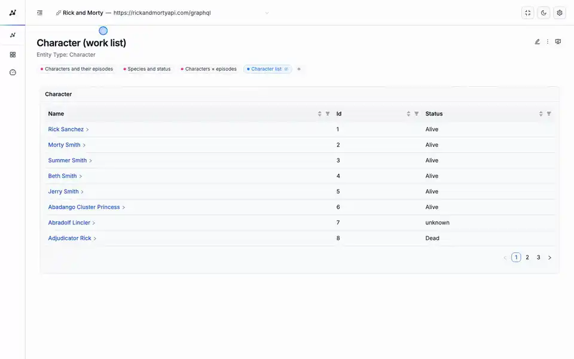
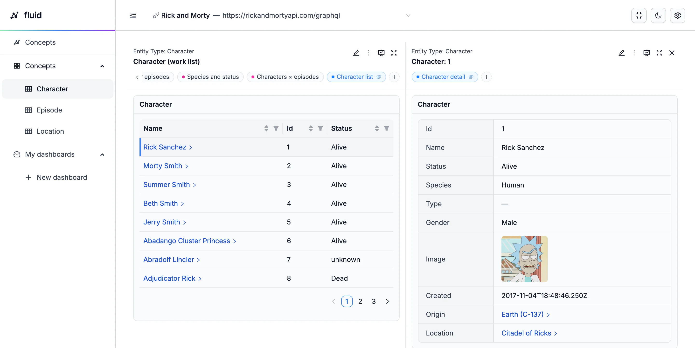
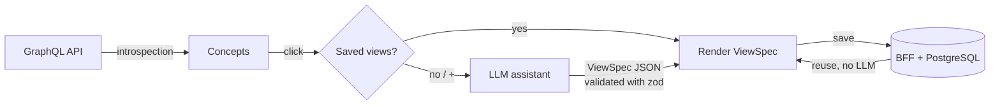
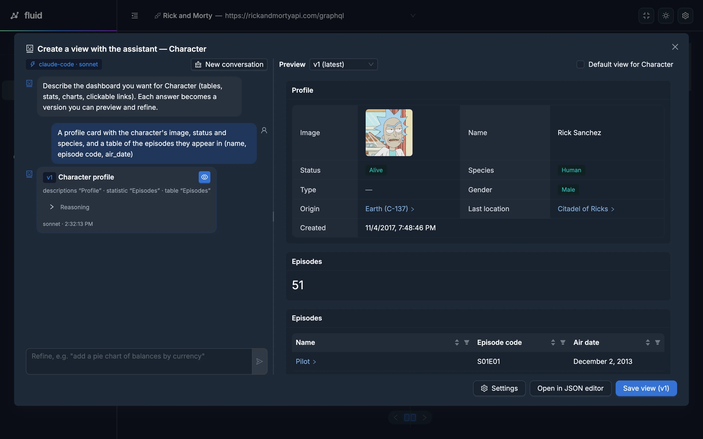
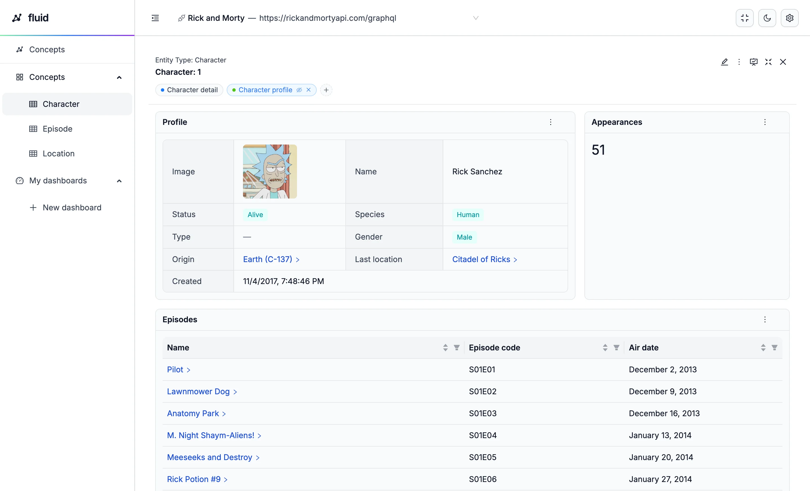
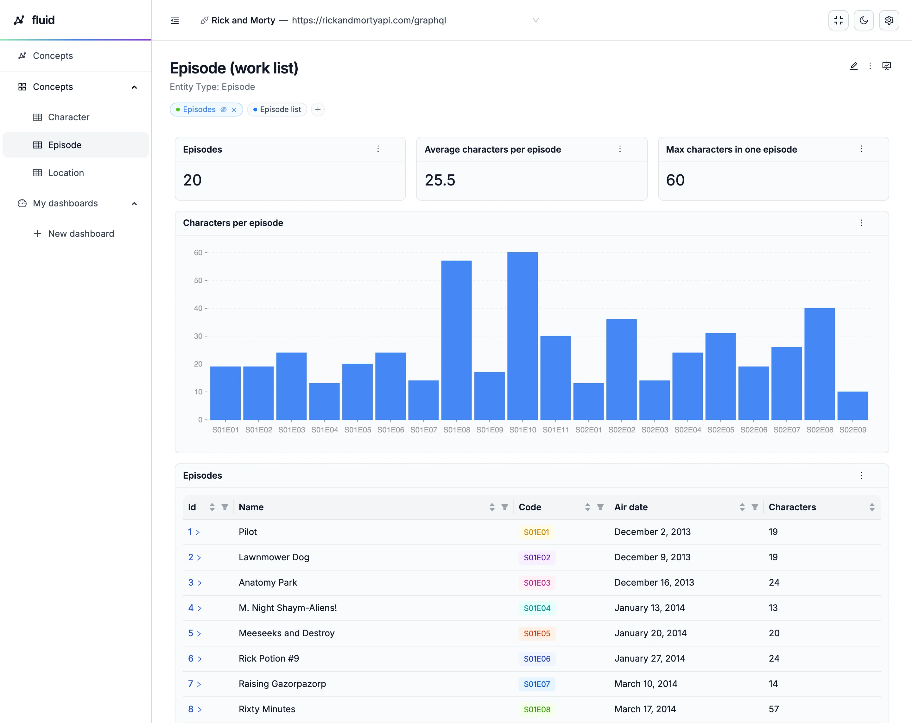
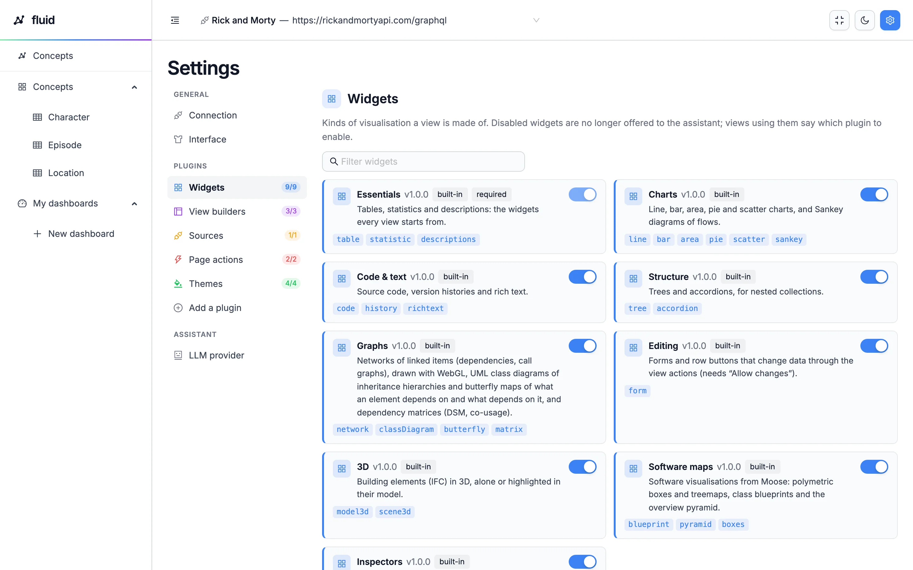
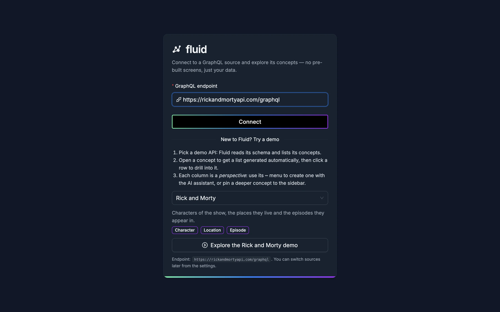

<div align="center">


# fluid

**Explore and shape your data the way Smalltalk inspectors let you explore objects, but on the web.**

Point fluid at any GraphQL API, browse its concepts, and describe the dashboard you want.
An LLM writes the view, you keep it, and it runs again without the LLM.

[**Live demo**](https://fluid.badetitou.fr) ·
[Quick start](#-quick-start) ·
[Getting started](#-getting-started) ·
[AI assistants (MCP)](#-use-fluid-from-an-ai-assistant-mcp) ·
[Plugins](#-plugins) ·
[Deployment](#-deployment) ·
[Architecture](docs/architecture/REARCHITECTURE.md)


<a href="docs/media/demo.mp4">
  
</a>

<sub>▶ <a href="docs/media/demo.mp4">Watch the full demo (MP4, 1 min)</a></sub>

</div>

---

## ⚡ Quick start

```bash
npx @badetitou/fluid                            # fluid on http://localhost:4001, no clone needed
LLM_PROVIDER=claude-code npx @badetitou/fluid   # generate views with your Claude Code login
```

Pick **Explore the Rick and Morty demo** on the connection screen, open a concept, and press **+**
on a column to describe the view you want. Options are listed in [Run with npx](#run-with-npx).

Prefer to stay in your AI assistant? Plug fluid into Claude Code (or any MCP host) and ask for views
from the conversation:

```bash
claude mcp add fluid -- npx -y @badetitou/fluid@latest mcp
```

See [Use fluid from an AI assistant (MCP)](#-use-fluid-from-an-ai-assistant-mcp).

## ✨ What is fluid?

fluid is an experiment in **interface-less web apps**. Instead of shipping pre-built screens, it
connects to a GraphQL endpoint, introspects its schema, and lets you **explore the concepts** (types)
of the backend yourself, column after column, like a Smalltalk inspector or a Miller-column browser.

Clicking a concept or an instance opens a **view**:

- 🗂️ **Views as inspector tabs.** If views already exist for that concept, fluid renders them, with a
  selector to switch between perspectives.
- 💬 **Describe, don't build.** If none exists (or you press **+**), an assistant opens, pre-prompted
  with the concept's schema and its neighbours. Say what you want to see; the LLM answers with a
  **declarative view spec** (tables, charts, stats: dashboards, not prose), streamed and previewed live.
- 💾 **Keep what you like.** Saved views are reused **without the LLM**: they take the concept (and
  instance) as a parameter and run as plain GraphQL queries.
- 🔌 **From your AI assistant.** `fluid mcp` lets Claude Code, Claude Desktop or VS Code list your
  views, run them and write new ones that fluid checks and keeps.
- 🧩 **Extend everything.** Widgets, themes, view builders, data sources and page actions are
  **plugins** you enable, disable or install from a URL.



## 🔄 How it works





Once saved, the view is one more perspective of the concept, reused for every instance without
calling the LLM again:



A **ViewSpec** is a hybrid model: a declarative JSON layout of parameterizable widgets, each bound to
a GraphQL query. It is rendered by an extensible widget catalog built on
[Ant Design](https://ant.design/) and [@ant-design/plots](https://charts.ant.design/).

## 🧱 Widget catalog

Widgets ship in built-in collections that you can turn on or off in *Settings → Plugins*:



| Collection | Widgets |
| --- | --- |
| **Essentials** | table, statistic, descriptions |
| **Charts** | line, bar, area, pie, scatter, sankey |
| **Code & text** | code, history, richtext |
| **Structure** | tree, accordion |
| **Graphs** | network (WebGL), class diagram, butterfly, dependency matrix |
| **Editing** | form (writes back through view actions) |
| **3D** | IFC building elements, alone or in their model (three.js, loaded on demand) |
| **Software maps** | polymetric boxes, class blueprint, overview pyramid (Moose) |
| **Inspectors** | Spec presenters served by Pharo / Moose backends |

> Exploring a **Moose** model? See [The Pharo image as an Open Views provider](docs/guides/moose-open-views.md):
> GraphQL from Moose-REST-API, Pharo inspector tabs from Spec-Fluid (an Open Views provider).

Each widget type is a **contract** (zod schema, LLM documentation, input/output ports) plus a renderer,
so the prompt only ever describes widgets the frontend can actually render.



## 🚀 Getting started

### Requirements

- Node.js ≥ 22 and [pnpm](https://pnpm.io/) (`npm i -g pnpm`, or Corepack)
- Optional: Docker (e.g. [Colima](https://github.com/abiosoft/colima) on macOS) to store data in PostgreSQL

### Run it

```bash
pnpm install    # 1. dependencies
pnpm dev        # 2. frontend + BFF in watch mode
```



fluid has no GraphQL backend of its own. The connection screen is pre-filled with the public
[Rick and Morty API](https://rickandmortyapi.com/graphql) and offers a few other public demo sources;
any CORS-enabled GraphQL endpoint with introspection works.

Copy `apps/bff/.env.example` to `apps/bff/.env` to configure the database and LLM providers. With
nothing set, the BFF uses an offline **mock** provider, so the assistant works out of the box.

<br clear="right" />

### Storage modes

The BFF stores views and preferences in one of two ways:

- **Embedded (default)**: with no `DATABASE_URL`, the BFF runs on [PGlite](https://pglite.dev)
  (PostgreSQL in WebAssembly) and keeps its data in `FLUID_DATA_DIR` (default `~/.fluid/data`).
  Migrations are applied at startup; no Docker needed.
- **PostgreSQL**: set `DATABASE_URL` (e.g. in `apps/bff/.env`) to use a Postgres server. The schema
  is managed with the Prisma CLI:

  ```bash
  docker compose up -d
  pnpm --filter @fluid/bff prisma:migrate
  ```

Secrets of configured sources (API keys, tokens) are stored encrypted (AES-256-GCM) with
`FLUID_SECRET_KEY`: 32 bytes, as 64 hex characters or base64 (`openssl rand -base64 32`). It is
required to store secrets when `DATABASE_URL` is set. In embedded mode it is generated once into
`<data dir>/secret.key` (mode 0600). Losing the key makes the stored secrets unreadable.

Outbound calls made for a source (GraphQL proxy, OAuth discovery, token endpoint) always refuse
link-local and cloud-metadata addresses (169.254.0.0/16, fe80::/10), checked after DNS resolution
on every request. Loopback and private networks stay allowed, since fluid is meant to reach
intranet and local APIs. On a deployment exposed to people who must not reach your internal
network, set `FLUID_BLOCK_PRIVATE_HOSTS=1` to refuse those too (loopback, 10/8, 172.16/12,
192.168/16, 100.64/10, fc00::/7).

OAuth sources: set `FLUID_PUBLIC_URL` (e.g. `https://fluid.example.com`) to the address fluid is
reached at. The redirect URI to register at the authorization server is
`<FLUID_PUBLIC_URL>/api/oauth/callback`; without it, it is built from the request's host, which is
fine locally but should not be relied on in production. Sign-ins in flight are kept in memory, so
run a single BFF process.

### Useful commands

| Command | What it does |
| --- | --- |
| `pnpm dev` | Run every workspace in dev mode |
| `pnpm build` | Build every workspace |
| `pnpm -r typecheck` | Typecheck every workspace |
| `pnpm test` | Run the tests (vitest) |
| `node scripts/arch-metrics.mjs` | Architecture health indicators (`--json` for the log) |

### Single-process mode

To run fluid as one process (no nginx, no separate dev server), build the frontend and let the BFF serve it:

```bash
pnpm --filter @fluid/frontend build
FLUID_STATIC_DIR=$PWD/apps/frontend/dist pnpm --filter @fluid/bff start
# open http://localhost:4001
```

The BFF then serves the app at `/` (unknown non-`/api` paths fall back to `index.html`) and a generated `/config.js` pointing at the same origin. `FLUID_DEFAULT_GRAPHQL_URL` and `FLUID_IMAGE_HOSTS` are honoured as in the Docker image. Without `FLUID_STATIC_DIR` the BFF behaves as before.

### Run with npx

No clone needed, only Node.js 22 or later:

```bash
npx @badetitou/fluid            # use @badetitou/fluid@latest to pick up updates
```

It starts fluid on http://localhost:4001 (embedded PGlite storage, offline mock LLM unless configured) and opens your browser.

| Option | Meaning |
| --- | --- |
| `--port N` | Port (default 4001, `0` = any free port) |
| `--host H` | Bind address (default `127.0.0.1`; the API has no auth, so expose it knowingly) |
| `--data-dir DIR` | PGlite data directory (default `~/.fluid/data`, or `FLUID_DATA_DIR`) |
| `--env-file F` | Load variables from a file (a `.env` in the current directory is never read) |
| `--no-open` | Do not open the browser |
| `--no-github` | Do not offer the [GitHub source](docs/guides/github-source.md) (on when `model-graphql` is found on `PATH` or in `~/.cargo/bin`) |
| `--model-graphql P` | Path of Model's `model-graphql`, for the GitHub source (or `FLUID_MODEL_GRAPHQL_BIN`) |
| `--verbose` | Request logs and stack traces |

Build and check the package locally with `pnpm pack:cli && pnpm test:pack` (tarball in `out/`). See `apps/cli/README.md`.

## 🔌 Use fluid from an AI assistant (MCP)

`fluid mcp` is an MCP server over stdio. It is a client of a **running fluid** (default
`http://localhost:4001`, or `--url` / `FLUID_URL`) and gives the assistant these tools:

- **Read**: `list_sources`, `list_views`, `show_view` (run a saved view and summarize it).
- **Write views**: `get_source_schema`, then `draft_view`: fluid validates the draft exactly like its
  own assistant (widgets, wiring, queries against the schema), runs it and returns the result or the
  issues to fix. The draft is kept with **Save in fluid** (`save_view`).
- **Viewer**: in hosts that support [MCP Apps](https://modelcontextprotocol.io/extensions/apps)
  (`ui://fluid/viewer`), the view is drawn live in the conversation, selections flow back to the
  assistant, and view actions (mutations) run only after you confirm, on sources where **Allow
  changes** is on.

Try it with Claude Code in three steps:

1. Start fluid: `npx @badetitou/fluid@latest`.
2. Connect to the Rick and Morty demo and turn on **Settings → Connection → Via the BFF**: the
   assistant only sees sources stored in the BFF.
3. Register the server, then start `claude` (`/mcp` should list **fluid**):

   ```bash
   claude mcp add fluid -- npx -y @badetitou/fluid@latest mcp
   ```

Then ask: *"Which sources does fluid have? Build me an overview of the episodes with their code,
name and air date."* For Claude Desktop, VS Code, a local build (`fluid mcp` needs 0.2.0 or
later), a full example draft and troubleshooting, read the
**[MCP guide](docs/guides/mcp.md)**.

## 🤖 LLM providers

| Provider | Setup |
| --- | --- |
| **Mock** | Default, offline, no setup |
| **OpenAI** (or any compatible API) | `OPENAI_API_KEY`, `OPENAI_MODEL`, `OPENAI_BASE_URL` |
| **Ollama** | `OLLAMA_BASE_URL`, `OLLAMA_MODEL` |
| **Claude** via your local Claude Code login | `claude` installed and logged in, see below |

> This is fluid's built-in assistant calling Claude. The other way round, Claude Code driving fluid,
> is [`fluid mcp`](#-use-fluid-from-an-ai-assistant-mcp).

Pick the default with `LLM_PROVIDER` (`openai | ollama | claude-code | mock`); users can override it in
**Settings → Configure LLM**.

<details>
<summary><b>Generating views with your Claude subscription</b></summary>

The assistant can use **Claude through your local Claude Code login** (Pro/Max subscription, no API key):

1. Install [Claude Code](https://docs.claude.com/en/docs/claude-code) on the machine that runs the
   BFF and run `claude` once to log in.
2. Start the stack with `pnpm dev`, open **Settings → Configure LLM** and pick
   **Claude (local Claude Code login)** (Sonnet by default, Opus or Haiku available).
3. Open a concept, press **+** and describe the view: Claude's output streams live, then the
   validated view is previewed and can be saved.

The BFF runs `claude -p` headless with tools, MCP servers, hooks and session persistence disabled,
using a Claude-tuned prompt. Optional env vars: `CLAUDE_CODE_BIN`, `CLAUDE_CODE_MODEL`,
`CLAUDE_CODE_TIMEOUT_MS`. This provider is meant for local use: the container images do not include
the CLI.

</details>

## 🧩 Plugins

A plugin is a JSON **manifest** (validated with zod) plus, optionally, an ES module. Each plugin has
one `kind`:

| Kind | Contributes |
| --- | --- |
| `theme` | Color tokens, fonts, radius, series palette (pure JSON) |
| `widget` | New widget types: contract + renderer |
| `viewBuilder` | Perspectives (ViewSpecs) for a column, optionally with a non-GraphQL data source |
| `sourceProvider` | GraphQL sources offered in the top-bar source switcher |
| `pageAction` | Commands in each column's floating action button |
| `graphDecorator` | Declarative rules over the connected graph: tags, derived edges, constraints (pure JSON) |

Built-in themes include badetitou, Solarized, High contrast and Catppuccin (Latte, Frappé, Macchiato,
Mocha, Matcha). Examples of installable plugins live in
[`apps/frontend/public/plugins`](apps/frontend/public/plugins) (`tagcloud`, `nord-theme`,
`local-sources`). The full API is in [`docs/architecture/PLUGINS.md`](docs/architecture/PLUGINS.md).

## 🗺️ Repository layout

```
fluid/
├── apps/
│   ├── frontend/   React + Vite + antd + urql: connect, explore, render views, assistant, MCP viewer
│   ├── bff/        Fastify + Prisma: LLM proxy, view persistence, source proxy, preferences
│   └── cli/        npx @badetitou/fluid: single-process fluid and the `fluid mcp` server
├── packages/
│   └── shared/     ViewSpec, widget contracts, zod schemas
├── charts/fluid/   Helm chart (frontend + BFF + PostgreSQL)
├── docs/           Guides (MCP, Moose), architecture notes, plugin API, health log
└── scripts/        Architecture metrics, README media capture (scripts/docs)
```

The frontend follows a layered architecture
(`app → pages → features → entities → engine → catalog → shared`) with small, single-purpose
components. See [`REARCHITECTURE.md`](docs/architecture/REARCHITECTURE.md) and the
[health log](docs/architecture/health-log.md).

## 📦 Deployment

The quickest way to host fluid is the all-in-one image, the same app as `npx @badetitou/fluid`:

```bash
docker run -p 127.0.0.1:4001:4001 -v fluid-data:/data ghcr.io/badetitou/fluid:latest
# or: docker compose -f deploy/docker-compose.yml up -d
```

It stores data with embedded PGlite in the `/data` volume. The API has no authentication, so only
expose it on networks you trust.

The image also ships `model-graphql` and enables the **GitHub source** (explore a public repository's
code model by typing `owner/name`). To use it outside the image, see the
[GitHub source guide](docs/guides/github-source.md) (`cargo install`, env vars, limits).

For a PostgreSQL-backed deployment, use the **Helm chart** ([`charts/fluid`](charts/fluid)), which
runs the frontend, the BFF and PostgreSQL and migrates the database.

### Images

GitHub Actions builds and pushes three images to GitHub Container Registry, tagged with the short commit sha,
`latest` (on `main`) and the release version (on `vX.Y.Z` tags):

| Image | Dockerfile | Use |
| --- | --- | --- |
| `ghcr.io/badetitou/fluid` | [`Dockerfile`](Dockerfile) | All in one (frontend + API + PGlite) |
| `ghcr.io/badetitou/fluid/fluid-bff` | [`apps/bff/Dockerfile`](apps/bff/Dockerfile) | Helm chart: BFF |
| `ghcr.io/badetitou/fluid/fluid-frontend` | [`apps/frontend/Dockerfile`](apps/frontend/Dockerfile) | Helm chart: nginx frontend, proxies `/api` to the BFF |

Build them locally from the repository root:

```bash
docker build -t fluid:dev .
docker build -f apps/bff/Dockerfile      -t fluid-bff:dev .
docker build -f apps/frontend/Dockerfile -t fluid-frontend:dev .
```

### Releasing

Push a tag `vX.Y.Z` on `main`. CI runs the checks, builds and smoke-tests the npm tarball with that
version, pushes the images, and publishes `@badetitou/fluid` to npm through
[Trusted Publishing](https://docs.npmjs.com/trusted-publishers) (no npm token in GitHub).

### Local cluster (kind / minikube)

```bash
kind load docker-image fluid-bff:dev fluid-frontend:dev

helm install fluid charts/fluid -f charts/fluid/values-local.yaml \
  --set ingress.enabled=false --namespace fluid --create-namespace

kubectl port-forward -n fluid svc/fluid-frontend 8080:80   # → http://localhost:8080/
```

An init container runs `prisma migrate deploy` before the BFF starts.

### Cloud

`charts/fluid/values-cloud.yaml` pulls images from GitHub Container Registry and enables an ingress with
TLS via cert-manager:

```bash
helm install fluid charts/fluid -f charts/fluid/values-cloud.yaml \
  --set image.tag=0.1.1 --set ingress.host=fluid.example.com
```

Browser-facing URLs are set at container start (`FLUID_BFF_URL`, `FLUID_DEFAULT_GRAPHQL_URL` →
`/config.js`), so one frontend image works for any deployment.

<details>
<summary><b>GitHub Pages (frontend only)</b></summary>

[`.github/workflows/pages.yml`](.github/workflows/pages.yml) builds the frontend as a static site
and publishes it on GitHub Pages on every push to `main`, at **<https://fluid.badetitou.fr>**. The
site is built for the domain root; set the repository variable `PAGES_BASE_PATH` to `/fluid/` to
serve it from `https://badetitou.github.io/fluid/` instead.

Setup: *Settings → Pages* → Source **GitHub Actions**, custom domain `fluid.badetitou.fr`, enforce
HTTPS, then add at the DNS provider:

- `fluid.badetitou.fr. CNAME badetitou.github.io.`
- optionally, verify the domain in the account's *Settings → Pages* (TXT record shown by GitHub)

Without a BFF the app still runs: views fall back to curated and automatic views, and preferences to
`localStorage`. Saving views and LLM generation need a BFF reachable from the browser. Configure it
with repository variables (*Settings → Secrets and variables → Actions → Variables*, written to
`config.js` at build time):

- `FLUID_BFF_URL`: BFF base URL (leave empty for no BFF; the BFF must allow CORS from the Pages origin).
- `FLUID_DEFAULT_GRAPHQL_URL`: GraphQL URL pre-filled on the connect screen (HTTPS, CORS allowed from
  the Pages origin).

</details>

## 🤝 Contributing

Issues and pull requests are welcome on [GitHub](https://github.com/badetitou/fluid). Keep pull
requests small, run `pnpm -r typecheck` and `pnpm test` before pushing, and follow the architecture
rules summarized in [`CLAUDE.md`](CLAUDE.md).

## 📄 License

[MIT](LICENSE)
