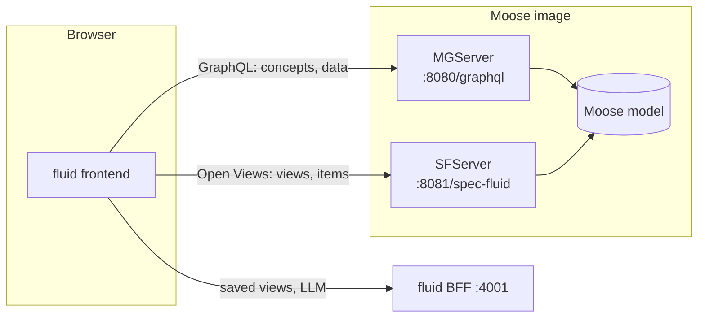

# The Pharo image as an Open Views provider

This guide connects fluid to a **Moose** image: you browse a software model (classes, methods,
packages…) as fluid concepts, open the **Pharo inspector tabs** of each entity (Navigation, Fame,
Blueprint, source…) right in fluid, and generate dashboards with the assistant.

The image is a **[fluid Open Views](../architecture/OPEN-VIEWS.md)** provider, the open protocol
through which any tool serves the views of its own objects: its `SFServer` (project Spec-Fluid) is one
provider among others, and fluid reads it with no Pharo-specific code. To write a provider for
another tool, start from the [plain Node example](../examples/open-views-provider/).

<a href="../media/moose-demo.mp4">
  
</a>

<sub>▶ <a href="../media/moose-demo.mp4">Watch the full demo (MP4, 2880×1800, 43 s)</a></sub>

Two Pharo projects do the work, both loaded in the same image:

| Project | Serves | Used by fluid for |
|---|---|---|
| [Moose-REST-API](https://github.com/evref-bl/Moose-REST-API) (package `Moose-GraphQL`) | GraphQL, `MGServer` | Concepts, lists, entity data, generated views |
| [Spec-Fluid](https://gitlab.com/badetitou/spec-fluid) | fluid Open Views, `SFServer` | Inspector tabs (as views) |



Both servers read the **same model** and use the **same entity ids** (`<modelId>:<mooseID>`, e.g.
`1:74008`). That is the Open Views contract: an object id in the provider's routes is the id of the
same object in the GraphQL source, and every `ref` a view carries points back into that source. So
fluid asks Spec-Fluid for the views of the entity a GraphQL column shows, and opens, as a GraphQL
entity, what you click in a Pharo tab.

## 1. Prepare the image

You need a Moose image (tested on Pharo 13 with Moose). In a Playground:

```st
Metacello new
  baseline: 'SpecFluid';
  repository: 'gitlab://badetitou/spec-fluid:main/src';
  load.
```

The Spec-Fluid baseline also loads Moose-GraphQL (Moose-REST-API `1.0.0`), so this one load gives
you both servers. Each [Spec-Fluid release](https://gitlab.com/badetitou/spec-fluid/-/releases) also
offers a ready-to-use Moose image with both loaded.

Load a model, from the Moose UI or by code:

```st
model := '/path/to/model.json' asFileReference
  readStreamDo: [ :s | FamixJavaModel new importFromJSONStream: s ].
model name: 'MyModel'; install.
```

Use the model class of your metamodel (`FamixJavaModel`, `FamixStModel`…) and
`importFromMSEStream:` for `.mse` files.

## 2. Start the servers

```st
model := MooseModel root detect: [ :m | m name = 'MyModel' ].
MGServer startOn: 8080 model: model.   "GraphQL, model mode"
SFServer start.                        "inspector tabs on 8081, follows MGServer's model"
```

Start `MGServer` in **model mode** (`startOn:model:` or `startOnModel:`): the entity types of the
model (`Class`, `Method`, `Package`…) become fluid concepts, and the GraphQL types match the ones
Spec-Fluid puts in its references, so a click in a Pharo tab opens the right concept. In generic
mode (`MGServer start`) there is no current model: Spec-Fluid then needs one explicitly
(`SFServer startOn: 8081 model: model`), and its references name types the generic schema does not
have.

Check both:

```bash
curl -s http://localhost:8080/graphql -H 'content-type: application/json' \
  -d '{"query":"{ classes(take: 2) { id name } }"}'
# {"data":{"classes":[{"id":"1:74008","name":"AIWeightedHits"}, …]}}

curl -s http://localhost:8081/spec-fluid/.well-known/fluid-views
# {"protocol":"fluid-views","version":1,"name":"Spec-Fluid","capabilities":{"actions":false,"evaluate":false}}

curl -s 'http://localhost:8081/spec-fluid/objects/1%3A74008/views'
# {"object":{"id":"1:74008","label":"AIWeightedHits","type":"Class"},
#  "views":[{"key":"miInspectionNavigation:","title":"Navigation","priority":1}, …]}
```

These are the first two routes of the [protocol](../architecture/OPEN-VIEWS.md#routes): the
**discovery** document, then the **views of an object**, one per inspector tab. Each tab's key is the
method that builds it, and its priority comes from `<inspectorPresentationOrder:title:>`. The rest of
the protocol follows from there:

```bash
curl -s 'http://localhost:8081/spec-fluid/objects/1%3A74008/views/miInspectionNavigation%3A'
# {"key":"miInspectionNavigation:","title":"Navigation","priority":1,
#  "view":{"kind":"tree","roots":[…],"total":9}}

curl -s 'http://localhost:8081/spec-fluid/objects/1%3A74008/views/miInspectionNavigation%3A/items?path=0&offset=0&limit=50'
# {"items":[…],"total":9}
```

A Spec presenter becomes a view node: a table is a `columnedList`, a tree a `tree`, a Roassal canvas
an `svg` whose shapes are `hotspots`, a notebook `tabs`, a code presenter `text` with its selection
in `highlights`. A long list or tree sends its first 100 items with `total`, and fluid pages the rest
through the **items** route; a tree node whose children were not sent carries `hasChildren`.

After the model changes (new entity types, re-import), run `MGServer restart`; Spec-Fluid picks up
the model again at its next request.

## 3. Run fluid locally

The image serves plain `http://localhost`: the public HTTPS deployment
([fluid.badetitou.fr](https://fluid.badetitou.fr)) cannot reach it, because browsers block mixed
content and requests to the private network. Run fluid on your machine, and point it at the image
from the start:

```bash
FLUID_DEFAULT_GRAPHQL_URL=http://localhost:8080/graphql npx @badetitou/fluid
```

Or from a clone (`VITE_DEFAULT_GRAPHQL_URL` in `apps/frontend/.env`, then `pnpm dev`). You can also
type the URL on the connection screen. To generate views, configure an LLM provider (see the
[README](../../README.md#-llm-providers)); for instance `LLM_PROVIDER=claude-code`.

## 4. Turn on the Open Views plugin

In **Settings → Plugins → Open Views**, add `http://localhost:8081/spec-fluid` to the endpoints (one
per line, next to any other provider). The Pharo image is one Open Views provider among others: the
views of all endpoints are merged by priority in the same detail columns.

The plugin stays silent while its endpoints are empty, and when the image does not answer. The
**Inspectors** widget collection (the `specPresenter` widget that draws a view) must stay enabled, as
well as **Software maps** if you want the Moose visualizations below.

> [!NOTE]
> `SFServer` only listens on loopback (`127.0.0.1`), and only answers web pages of a loopback
> origin (`localhost`, `127.0.0.1`…), so other machines and other web sites cannot use it.

## 5. Explore

- **Concepts.** The concepts are the entity types of the model. Open
  `Class`, then a class: its detail column opens.
- **Inspector tabs.** The perspective selector of the detail column lists the saved views of the
  concept, then the views the image declares for the entity (Navigation, SourceText, Fame,
  Blueprint, Tree…), by priority. They are drawn as Pharo built them: tables, trees, Roassal
  canvases (SVG), source code with its selection highlighted, diffs and notebooks. Long lists show
  *Load more*, and tree nodes load their children when you unfold them.
- **Navigate.** A row, a cell, a tree node or a Roassal shape that names an entity is a link: it
  opens that entity in the next column, with its own tabs.
- **Generate views.** Press **+** on a column and describe what you want, e.g. *"a table of the
  methods of this class with their lines of code, sorted by size"*. The assistant writes a view on
  the GraphQL schema of the model, which you save and reuse on every class without the LLM. The
  **Software maps** collection adds Moose visualizations the assistant can use: polymetric
  `boxes`, class `blueprint` and `pyramid` (overview pyramid).
- **Mix both.** A saved view can hold a Pharo tab next to GraphQL widgets: a `specPresenter` widget
  emits the entity you click on its `selected` port, and another widget can follow it
  (`{ "query": "@<widget id>", "path": "selected" }`).

## Add your own tab

Spec-Fluid serves the tabs the Pharo inspector already has, so a new inspector tab becomes a new
Open Views view, and shows up in fluid too, with no change on the fluid side:

```st
FamixJavaClass >> inspectionMethodsBySize: aBuilder
	<inspectorPresentationOrder: 50 title: 'Methods by size'>
	^ aBuilder newTable
		items: (self methods asSortedCollection: [ :a :b | a numberOfLinesOfCode > b numberOfLinesOfCode ]);
		addColumn: (SpStringTableColumn title: 'Method' evaluated: #name);
		addColumn: (SpStringTableColumn title: 'LOC' evaluated: #numberOfLinesOfCode);
		yourself
```

Rows whose item is an entity carry a `ref`, and are clickable in fluid. Build tabs from lists,
tables, trees, text, labels, diffs, notebooks and Roassal canvases, or layouts of those; other
presenters become `unsupported` nodes. The view format is the
[Open Views protocol](../architecture/OPEN-VIEWS.md#view-nodes); how Spec-Fluid maps presenters to it
is described in the [Spec-Fluid README](https://gitlab.com/badetitou/spec-fluid).

The same tab could come from any other tool: a Python or Node service that answers the same routes
for these entity ids adds its views next to Pharo's (see the
[provider example](../examples/open-views-provider/)).

## Troubleshooting

| Symptom | Cause and fix |
|---|---|
| fluid cannot connect to the GraphQL URL | `MGServer isRunning`? fluid served over HTTPS cannot reach `http://localhost`: run it locally. |
| Concepts are `Model`, `Entity`, `MetaClass`… | `MGServer` runs in generic mode: restart it with `MGServer startOn: 8080 model: model`. |
| No Pharo tabs in the perspective selector | Open Views endpoint not set, or `SFServer isRunning` is false. Open `http://localhost:8081/spec-fluid/.well-known/fluid-views` in the browser to check. |
| A tab says *sent an unexpected answer* | The image sends a view that does not match the [schema](../architecture/open-views.schema.json): update Spec-Fluid, and report the tab if it persists. |
| *Origin not allowed* (403) | fluid is served from another origin than `localhost`/`127.0.0.1`: run `SFServer allowOrigin: 'http://<host>:<port>'` with the origin in the address bar. |
| Every object answers 404 `object-not-found` | No model to serve: start `MGServer` in model mode, or `SFServer startOn: 8081 model: model`. |
| A tab says *Unknown entity* | The ids changed: mooseIDs differ from one image (or import) to another. Reload the concept in fluid. |
| Clicking an entity in a tab opens nothing | Its GraphQL type is unknown (generic mode, or a type with no instances): use model mode. |
| A part of a tab is *unsupported* | That Spec presenter has no Spec-Fluid export yet; the rest of the tab is still shown. |
| Wrong types after changing the metamodel | `MGServer restart` and `SFModelContext resetCache`. |
