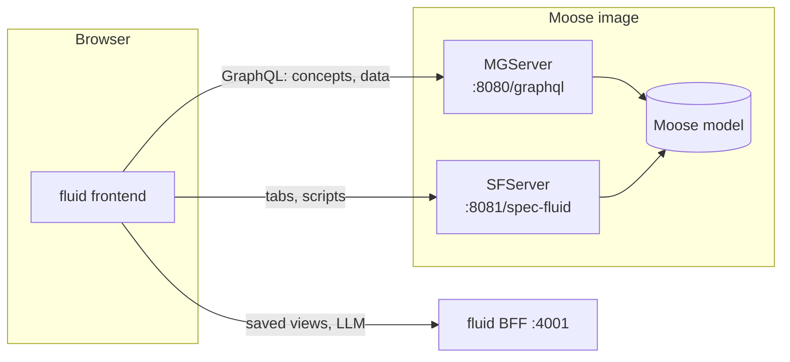

# Exploring a Moose model with fluid

This guide connects fluid to a **Moose** image: you browse a software model (classes, methods,
packages…) as fluid concepts, open the **Pharo inspector tabs** of each entity (Navigation, Fame,
Blueprint, source…) right in fluid, generate dashboards with the assistant, and run Smalltalk on an
entity from the browser.

<a href="../media/moose-demo.mp4">
  
</a>

<sub>▶ <a href="../media/moose-demo.mp4">Watch the full demo (MP4, 46 s)</a></sub>

Two Pharo projects do the work, both loaded in the same image:

| Project | Serves | Used by fluid for |
|---|---|---|
| [Moose-REST-API](https://github.com/evref-bl/Moose-REST-API) (package `Moose-GraphQL`) | GraphQL, `MGServer` | Concepts, lists, entity data, generated views |
| [Spec-Fluid](https://gitlab.com/badetitou/spec-fluid) | JSON, `SFServer` | Inspector tabs, Pharo scripts |



Both servers read the **same model** and use the **same entity ids** (`<modelId>:<mooseID>`, e.g.
`1:74008`). That is what lets fluid ask Spec-Fluid for the tabs of the entity a GraphQL column shows,
and open, as a GraphQL entity, what you click in a Pharo tab.

## 1. Prepare the image

You need a Moose image (tested on Pharo 13 with Moose). In a Playground:

```st
Metacello new
  baseline: 'SpecFluid';
  repository: 'gitlab://badetitou/spec-fluid:main/src';
  load.
```

The Spec-Fluid baseline also loads Moose-GraphQL (Moose-REST-API `1.0.0`), so this one load gives
you both servers. Each [Spec-Fluid release](https://gitlab.com/badetitou/spec-fluid/-/releases) also
offers a ready-to-use Moose image with both loaded.

Load a model, from the Moose UI or by code:

```st
model := '/path/to/model.json' asFileReference
  readStreamDo: [ :s | FamixJavaModel new importFromJSONStream: s ].
model name: 'MyModel'; install.
```

Use the model class of your metamodel (`FamixJavaModel`, `FamixStModel`…) and
`importFromMSEStream:` for `.mse` files.

## 2. Start the servers

```st
model := MooseModel root detect: [ :m | m name = 'MyModel' ].
MGServer startOn: 8080 model: model.   "GraphQL, model mode"
SFServer start.                        "inspector tabs on 8081, follows MGServer's model"
```

Start `MGServer` in **model mode** (`startOn:model:` or `startOnModel:`): the entity types of the
model (`Class`, `Method`, `Package`…) become fluid concepts, and the GraphQL types match the ones
Spec-Fluid puts in its references, so a click in a Pharo tab opens the right concept. In generic
mode (`MGServer start`) there is no current model: Spec-Fluid then needs one explicitly
(`SFServer startOn: 8081 model: model`), and its references name types the generic schema does not
have.

Check both:

```bash
curl -s http://localhost:8080/graphql -H 'content-type: application/json' \
  -d '{"query":"{ classes(take: 2) { id name } }"}'
# {"data":{"classes":[{"id":"1:74008","name":"AIWeightedHits"}, …]}}

curl -s http://localhost:8081/spec-fluid
# {"name":"Spec-Fluid","version":"0.2.0","model":"MyModel","evaluates":false}

curl -s 'http://localhost:8081/spec-fluid/entities/1%3A74008/tabs'
# {"entity":{"id":"1:74008","name":"AIWeightedHits","type":"Class"},
#  "tabs":[{"key":"miInspectionNavigation:","title":"Navigation","order":1}, …]}
```

After the model changes (new entity types, re-import), run `MGServer restart`; Spec-Fluid picks up
the model again at its next request.

## 3. Run fluid locally

The image serves plain `http://localhost`: the public HTTPS deployment
([fluid.badetitou.fr](https://fluid.badetitou.fr)) cannot reach it, because browsers block mixed
content and requests to the private network. Run fluid on your machine, and point it at the image
from the start:

```bash
FLUID_DEFAULT_GRAPHQL_URL=http://localhost:8080/graphql npx @badetitou/fluid
```

Or from a clone (`VITE_DEFAULT_GRAPHQL_URL` in `apps/frontend/.env`, then `pnpm dev`). You can also
type the URL on the connection screen. To generate views, configure an LLM provider (see the
[README](../../README.md#-llm-providers)); for instance `LLM_PROVIDER=claude-code`.

## 4. Turn on the Pharo plugins

In **Settings → Plugins**, set the **Spec-Fluid endpoint** to `http://localhost:8081/spec-fluid` on:

| Plugin | Adds |
|---|---|
| **Spec-Fluid (Pharo inspectors)** (view builder) | The inspector tabs of an entity, as perspectives of its detail column |
| **Pharo script** (page action) | A Smalltalk editor on the entity of a detail column |

Both stay silent while the endpoint is empty, and when the image does not answer. The
**Inspectors** widget collection (the `specPresenter` widget that draws a tab) must stay enabled, as
well as **Software maps** if you want the Moose visualizations below.

## 5. Explore

- **Concepts.** The concepts are the entity types of the model. Open
  `Class`, then a class: its detail column opens.
- **Inspector tabs.** The perspective selector of the detail column lists the saved views of the
  concept, then the Pharo tabs of the entity (Navigation, SourceText, Fame, Blueprint, Tree…), in
  Pharo's order. They are drawn as Pharo built them: tables, trees, Roassal canvases (SVG), source
  code with its selection highlighted, diffs and notebooks.
- **Navigate.** A row, a cell, a tree node or a Roassal shape that names an entity is a link: it
  opens that entity in the next column, with its own tabs.
- **Generate views.** Press **+** on a column and describe what you want, e.g. *"a table of the
  methods of this class with their lines of code, sorted by size"*. The assistant writes a view on
  the GraphQL schema of the model, which you save and reuse on every class without the LLM. The
  **Software maps** collection adds Moose visualizations the assistant can use: polymetric
  `boxes`, class `blueprint` and `pyramid` (overview pyramid).
- **Mix both.** A saved view can hold a Pharo tab next to GraphQL widgets: a `specPresenter` widget
  emits the entity you click on its `selected` port, and another widget can follow it
  (`{ "query": "@<widget id>", "path": "selected" }`).

## 6. Run Smalltalk on an entity

Pharo scripts are off by default, because they run any code in the image. Turn them on in the
image:

```st
SFServer enableEvaluation.
```

Then, on a detail column, open the floating button and choose **Pharo script**. `self` is the
entity of the column; run with ⌘/Ctrl + Enter:

```st
self methods select: [ :m | m numberOfLinesOfCode > 30 ]
```

The answer shows the result's display string. When the result is an entity of the model, it opens
in the next column; when it is a collection, its first 200 elements are listed and the entities
among them are links. Errors, halts and warnings are reported (422), and a script stops after 30
seconds. Turn evaluation off with `SFServer disableEvaluation`.

> [!WARNING]
> `SFServer` only listens on loopback (`127.0.0.1`), and only answers web pages of a loopback
> origin (`localhost`, `127.0.0.1`…), so other machines and other web sites cannot use it. Any
> program on your machine can still run code while evaluation is on: turn it off when you are done.

## Add your own tab

Spec-Fluid serves the tabs the Pharo inspector already has, so a new inspector tab shows up in
fluid too, with no change on the fluid side:

```st
FamixJavaClass >> inspectionMethodsBySize: aBuilder
	<inspectorPresentationOrder: 50 title: 'Methods by size'>
	^ aBuilder newTable
		items: (self methods asSortedCollection: [ :a :b | a numberOfLinesOfCode > b numberOfLinesOfCode ]);
		addColumn: (SpStringTableColumn title: 'Method' evaluated: #name);
		addColumn: (SpStringTableColumn title: 'LOC' evaluated: #numberOfLinesOfCode);
		yourself
```

Rows whose item is an entity are clickable in fluid. Build tabs from lists, tables, trees, text,
labels, diffs, notebooks and Roassal canvases, or layouts of those; other presenters appear as
*unsupported*. The document format and its limits are described in the
[Spec-Fluid README](https://gitlab.com/badetitou/spec-fluid).

## Troubleshooting

| Symptom | Cause and fix |
|---|---|
| fluid cannot connect to the GraphQL URL | `MGServer isRunning`? fluid served over HTTPS cannot reach `http://localhost`: run it locally. |
| Concepts are `Model`, `Entity`, `MetaClass`… | `MGServer` runs in generic mode: restart it with `MGServer startOn: 8080 model: model`. |
| No Pharo tabs in the perspective selector | Endpoint not set, or `SFServer isRunning` is false. Open `http://localhost:8081/spec-fluid` in the browser to check. |
| *Origin not allowed* (403) | fluid is served from another origin than `localhost`/`127.0.0.1`: run `SFServer allowOrigin: 'http://<host>:<port>'` with the origin in the address bar. |
| `curl …/spec-fluid` answers `"model": null` | No model to serve: start `MGServer` in model mode, or `SFServer startOn: 8081 model: model`. |
| A tab says *Unknown entity* | The ids changed: mooseIDs differ from one image (or import) to another. Reload the concept in fluid. |
| Clicking an entity in a tab opens nothing | Its GraphQL type is unknown (generic mode, or a type with no instances): use model mode. |
| A part of a tab is *unsupported* | That Spec presenter has no Spec-Fluid export yet; the rest of the tab is still shown. |
| *Code evaluation is turned off in the image* | Run `SFServer enableEvaluation`. |
| Wrong types after changing the metamodel | `MGServer restart` and `SFModelContext resetCache`. |
